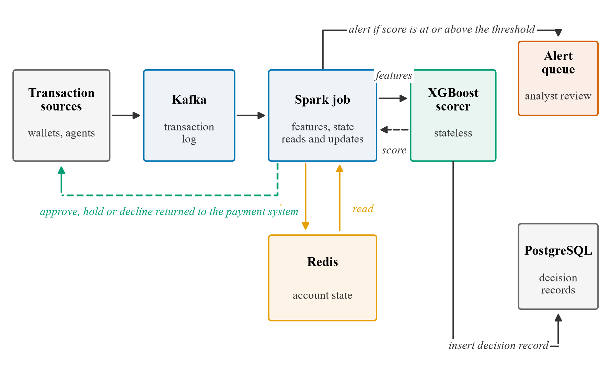

# FraudShield

A real-time fraud detection system for high-volume financial transaction streams, evaluated on the full 6.36M-transaction PaySim dataset. The repository holds a runnable reference implementation of the scoring pipeline (a partitioned log, a decision record, an apply-once state update, keyed alerts and one worker per partition) that can be crashed on purpose, plus the experiments behind it: a causal feature scheme, two evaluation protocols (random and temporal), five seeds, a feature-group ablation and latency benchmarks. The production stack of Kafka, Spark, Redis and PostgreSQL is specified and not deployed; the reference implementation stands in for it using files and SQLite.

This is the research codebase behind my MSc thesis at Lead City University and a manuscript prepared for *Bridges* (FASCON 2026), under double-blind review, so the manuscript itself isn't included here. A companion write-up on the QA methodology used to structure this project's own tooling decisions is on [Zenodo](https://doi.org/10.5281/zenodo.22341782).

Release v1.0.1 of this repository is the version the thesis cites.

## The problem

Rule-based fraud detection (fixed thresholds, cooldowns, blacklists) catches almost nothing. On this dataset, PaySim's own flag catches **16 of 8,213** real fraud cases (recall 0.19%). Machine learning does far better, but most published fraud-detection studies on this dataset evaluate under a random train/test split, which quietly lets the model see transactions "from the future" relative to some test rows, and a real deployed system never can. This project asks a narrower, more honest question: **how well does a causally correct, streaming-architected system actually perform when it can only ever see the past, and how much of a near-perfect result is real signal versus an artefact of the benchmark itself?**

## Architecture



The specified architecture publishes every transaction to **Kafka**, computes features on the fly in a **Spark Streaming** job against per-account behavioural state held in **Redis**, scores with a trained **XGBoost** model, and persists a decision record to **PostgreSQL** for the audit trail, all against an explicit one-second end-to-end latency budget. That stack is a design and has not been deployed. The allocation of the budget (100, 300, 50, 200 and 350 ms) is a design allocation, not a measurement.

### Reference implementation (`system/`)

`system/` is a Python implementation of the thesis's Algorithm 3.1, the idempotent transaction-scoring pipeline. It keeps the logic of the design (order of steps, atomic units, crash windows, deduplication keys) and replaces the infrastructure:

| Specified | Reference implementation |
|---|---|
| Kafka topic, partitioned by origin account | Append-only partitioned file log |
| Consumer-group offset commit | A row in an `offsets` table, written last |
| PostgreSQL decision record, insert if absent | SQLite `decisions` table, `INSERT OR IGNORE` |
| Redis hashes and the apply-once Lua script | SQLite `acct_state` table and one atomic upsert |
| Keyed alert queue | `alerts` table keyed by transaction identifier |
| Spark Streaming job | One worker process per partition |
| XGBoost scorer | The 8 trees of the temporal model, walked in Python (threshold 0.732) |

The algorithm has one step beyond the original design: a `state_applied` marker is set after both state updates, and on replay the state step is skipped if the marker is set. It is needed because the recent-identifier list kept per account (capped at about 16 to 20 ids) can be overrun by late duplicates on busy accounts.

The scorer matches XGBoost to 1.2e-7 and gives the same flag on all 6,362,620 events.

## Results

| Detector | Split | PR-AUC | Precision | Recall | Missed frauds |
|---|---|---|---|---|---|
| PaySim's own flag | n/a | n/a | 1.000 | 0.19% | 8,197 / 8,213 |
| Logistic Regression | random | 0.565 | 0.625 | 0.548 | n/a |
| Random Forest | random | 0.998 | 1.000 | 0.996 | 7 / 1,643 |
| **XGBoost** | random | **0.9986** | 1.000 | 0.997 | 5 / 1,643 |
| **XGBoost** | **temporal** | **0.9997** | 1.000 | 0.995 | 22 / 4,570 |

- **Five seeds (42 to 46)**: mean missed frauds at the validation threshold 21.6 (XGBoost) and 34.8 (random forest); both ensembles miss 2 at the best single threshold
- **Pre-authorisation** (19 features, no post-posting fields, with a drain indicator): PR-AUC 0.99971 (XGBoost), 0.99992 (random forest)
- **Scoring call alone** (in process, one laptop): median 0.16 ms on one thread and 0.36 ms on all threads for the eight-tree model; random forest about 29.5 ms (all threads) and 4.8 ms (one thread). Batched throughput 1.89 to 2.01 million events per second.

All figures come from `results/*.json`. The PaySim numbers are an upper bound: a three-condition rule and a depth-3 tree get close to the ensembles.

### Reference implementation under fault injection

| Result | Value |
|---|---|
| Injected crashes (hard process kill, `os._exit`, at six named points: after score, after insert, between state updates, after state, after mark, after alert) | 1,304 in total |
| Runs with crashes that passed all five invariants | every one |
| Duplicate deliveries (5% of events, up to 5,000 positions late) | pass |
| Negative control, marker ignored, sparse PaySim accounts (E4n) | still passes |
| Negative control, marker ignored, 2,000 late duplicates on busy accounts (E4hn) | **fails**, 44 account states wrong |
| Same busy-account run with the marker (E4h) | passes |

The five invariants checked after every run are: one decision per event and none missing; scores equal to the fault-free run where one covers the same events and within 2e-7 of the offline model; final account state equal to an independent dictionary replay; the alert set equal to the flagged set with no duplicate alerts; and the committed offset equal to the length of the log. The unit tests in `system/tests` reproduce the marker result on synthetic data.

Full stream, one worker, local stores: all 6,362,620 events at about 4,700 events per second, with per-event time (lookup to offset commit) of 0.137 ms at the median, 0.79 ms at p99 and 277 ms at the maximum. All invariants pass.

Scaling with 1, 2 and 4 consumers (one partition each) gave about 6,000, 5,700 and 5,600 events per second, so throughput did not scale; the single-writer SQLite file is the likely cause, not isolated. With 2 consumers 10,362 scores and 2 flags differed from stream order, and with 4 consumers 15,231 scores and 5 flags, which is the destination-ordering effect described in Section 3.2.1 of the thesis.

### Feature-group ablation

| Feature group | Features | PR-AUC |
|---|---|---|
| Transaction attributes only | 8 | 0.294 |
| + raw balances | 12 | 0.969 |
| + balance-consistency checks | 17 | 0.9997 |
| **Full set (+ velocity)** | **23** | **0.9997** |
| Transaction + velocity, *no* balance data | 14 | 0.463 |

The signal sits in balance fields and their consistency residuals. In PaySim, errBalOrig is exactly zero for 99.45% of fraud and nonzero for most legitimate transfers, so the fraud is the consistent class. That is a property of the simulator and not a result a real ledger would reproduce. Velocity features add nothing on the full set (G4 against G3) and matter only when balances are absent (G5, PR-AUC 0.463). Single-run counts of missed frauds depend on the validation threshold, so the thesis also reports the zero-false-positive threshold and the five-seed means.

## Repository structure

```
system/                      # reference implementation of the scoring pipeline
  fraudshield/               # log, stores, scorer, features, worker, fault points
  tests/test_protocol.py     # protocol tests on a synthetic stream (no dataset needed)
  model/                     # the 8-tree temporal XGBoost model used by the scorer
  train_model.py             # trains the temporal model
  prepare_reference.py       # caches the event stream and offline scores
  check_scorer_parity.py     # tree-walk scorer against XGBoost on all events
  run_fault_injection.py     # E1 to E6: crashes, duplicates, negative controls
  run_scaling.py             # 1, 2 and 4 consumer processes
  run_full_stream.py         # all 6,362,620 events with the full set of checks
experiments/
  run_experiments.py         # LR / RF / XGBoost, random + temporal splits, latency benchmark
  run_ablation.py            # five nested feature-group ablation (G1 to G5)
  run_causal_comparison.py   # causal against non-causal feature construction
  run_multiseed.py           # five seeds: ablation, comparator, pre-authorisation sets
  summarise_multiseed.py     # means and ranges from the multi-seed results
  run_threshold_free.py      # PR-AUC, ROC-AUC, bootstrap intervals, recall at fixed false-alarm budgets
  run_mcnemar.py             # exact McNemar test for random forest against XGBoost
  run_parity_replay.py       # replay of the feature scheme against an independent implementation
  incremental_features.py    # per-event dictionary implementation used by the replay
  run_latency_v2.py          # latency and throughput by model, trees and threads
  run_rolling_origin.py      # five split origins, XGBoost and random forest
  run_cluster_bootstrap.py   # cluster bootstrap by destination account and by fraud pair
  run_baselines_extra.py     # log-transformed logistic regression, depth-3 and depth-6 trees
  run_error_analysis.py      # the frauds the models miss on the temporal split
  run_consistency_stats.py   # descriptive statistics quoted in the thesis
  r6_common.py               # shared data preparation for the scripts above
  make_figures.py            # figures from results/
  make_figures_r6.py         # revised figures 1 to 5 and 7
  make_sequence_diagram.py   # Fig 8, Algorithm 3.1 as a sequence diagram
  make_ml_taxonomy.py        # Fig 9, ML paradigm taxonomy
  make_latency_budget_chart.py  # Fig 10, latency budget against measured
  check_refs.py              # cross-checks thesis endnotes against the bibliography
results/
  metrics.json, ablation.json, multiseed.json, ...   # every number in the tables above, raw
  system_*.json              # fault injection, full stream, scaling, scorer parity
  curves_random.npz, curves_temporal.npz, latency.npz
figures/
  fig1_architecture.png ... fig10_latency_budget.png  (300 dpi)
```

## Reproducing this

```bash
pip install -r requirements.txt
python -m pytest system/tests      # protocol tests on synthetic data, no dataset needed
```

The dataset is [PaySim](https://www.kaggle.com/datasets/ealaxi/paysim1) (Kaggle). Download it and point `DATA` at the top of the experiment scripts to your local copy, for example via `kagglehub.dataset_download("ealaxi/paysim1")` (the `system/` scripts read the `PAYSIM_CSV` environment variable or the kagglehub cache). Then:

```bash
python experiments/run_experiments.py   # ~5 min, writes results/metrics.json + figures 2-6
python experiments/run_ablation.py      # ~2 min, writes results/ablation.json + figure 7
python experiments/make_figures.py      # regenerate figures from saved results only

python system/train_model.py            # trains the temporal model, writes system/model/
python system/prepare_reference.py      # caches the event stream and offline scores
python system/check_scorer_parity.py    # tree-walk scorer against XGBoost
python system/run_fault_injection.py    # E1 to E6, writes results/system_fault_injection.json
python system/run_scaling.py            # 1, 2 and 4 consumers
python system/run_full_stream.py        # all 6,362,620 events
```

The crash runs take the first 100,000 events (30,000 for the single-point and flagged-only runs), and the fault-injection script resumes from the result file if interrupted.

## Causal feature scheme

23 features across three families, every one constructed so it can only use information that existed strictly before the transaction being scored:

- **Transaction attributes**: amount, hour, day, type
- **Balance-consistency**: accounting-identity checks (does the sender's new balance equal old balance minus amount?)
- **Velocity**: per-account behavioural state (prior transaction count, time since last activity), computed with a cumulative count/shift keyed to transaction order, never a naive groupby aggregate, to eliminate look-ahead leakage

## Limitations, stated directly

- The fault injection covers process crashes only. Machine, broker, store and network failure are not covered.
- The reference implementation uses local files and SQLite, so its times (0.137 ms median per event) are lower bounds for a networked deployment, and the one-second budget split remains a design allocation.
- The crash runs use the first 100,000 events; only the fault-free run uses the full stream.
- Kafka, Spark, Redis and PostgreSQL are specified and not deployed.
- Throughput did not scale with consumers, and with several consumers scores differed from stream order.
- PaySim's fraud pattern is stationary. This shows the model does not cheat by looking at the future, but cannot show it holds up against an adversary that adapts over time (real concept drift).
- The F1-maximised decision threshold is a defensible default, not a claim about a production cost function.

## Citation

```
Fatayo, M. A. "FraudShield: A Real-Time Machine Learning Framework for Fraud
Detection in High-Volume Financial Transaction Streams." Manuscript prepared
for Bridges (FASCON 2026), Lead City University, Ibadan.
```

See also `CITATION.cff` for the software citation (repository https://github.com/mafatayo/fraudshield, Release v1.0.0).

## License

MIT, see [LICENSE](LICENSE).
